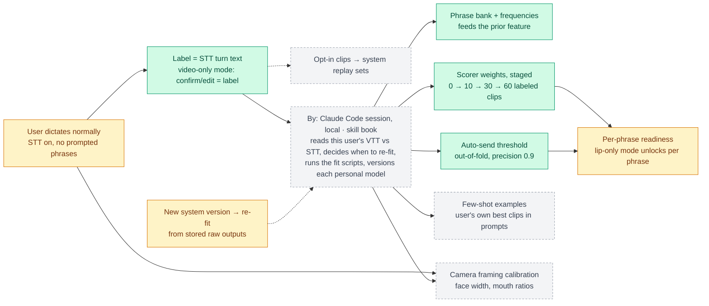
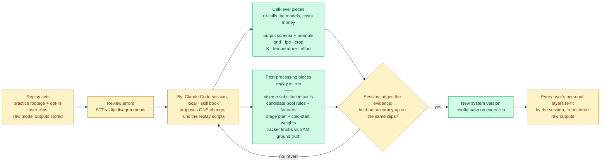
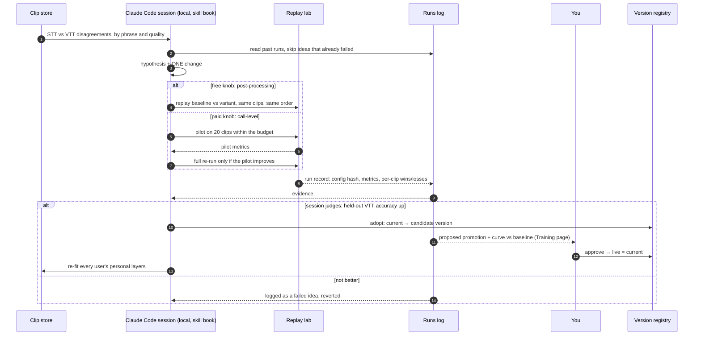

# badge-machine

Lip reading from a laptop webcam: a muted mouth crop goes to Muse Spark (K open samples plus a closed call) and Gemini
in parallel, and a trainable scorer picks the answer, **VTT** (video-to-text; per model "VTT · Gemini" / "VTT · Muse").
It trains passively from everyday dictation, where **STT** (speech-to-text) of each spoken turn is the label, and it
improves itself: every change is a version, adopted only if held-out word accuracy rises. Lip reading is a hard,
tightly coupled task (a change anywhere shifts everything downstream), which makes it a real test of that
self-improvement claim ([docs/self-improvement.md](docs/self-improvement.md)).

> **Where it stands (2026-11-07):** the pieces below are built and tested, but **no real-data training run has happened
> yet**. The only training curve so far comes from a simulated world, and it is labeled "simulated" everywhere below.

## Status

### Built and verified (on `main`; 523 Python + 16 Node tests green)
- **Live clip path:** browser tracker → server-side median mouth crop → Muse Spark ×K + closed call + Gemini →
  candidate pool → features → staged scorer → VTT, with raw outputs, usage and config stored on MongoDB Atlas.
  Measured live: ≈ $0.11 per clip at K=5, ≈ 42 s per clip end to end; tracker 0.035 face-width error at ~2 ms/frame.
- **Replay lab** (`experiment.py`, `runs.py`, `readiness.py`): 60/20/20 train / held-out / test splits; VTT, word,
  viseme and top-3 accuracy plus cost per clip. Replays are free because raw model outputs are stored and features are
  recomputed. Its demo numbers come from 80 simulated clips.
- **Lip mode + Dictation pages** (`static/lipmode.html`, `static/dictation.html`, `static/capture.js`): headless-Chrome
  e2e on a real talking-head camera, with the server endpoints stubbed. Lip mode stops a held take at 8 s.
- **Dictation sessions** (`sessions.py`, `asr.py`): a recording is cut at our own pauses into 2–8 s turns (Muse sees at
  most 48 images × 2×2 frames at 24 fps = 8.0 s), and each turn is labeled by its own STT call.
- **Version registry + held-out gate** (`versions.py`, `evaluator.py`, `iterate.py`): a baseline plus one change per
  version, each with a config hash; `current` moves only on held-out evidence, `live` only with user approval.
  `iterate.py`'s coded gate is held-out word accuracy ≥ +1 pt AND viseme accuracy down ≤ 0.5 pt, and its proposer sees
  train failures only, never held-out or test clips.

### In progress
- Server wiring: `POST /vtt`, `POST /vtt/<id>/label`, `POST /dictation`, `GET /sessions[...]`, `/runs`, `/readiness`,
  `/versions`.
- Session robustness: resume after a restart, retries, practice datasets exempt from the 50/day cap, coverage seconds.
- Instruments for the iterating session: two-version replay compare, failures by cause, recipe + clip inspector.

### Next
1. **Pilot:** one webcam-emulated Obama session, ~10 turns, ≈ $1.10; checked in Dataset → Clips → Stats.
2. **Run 1:** 150 utterances (≈ $17) or 300 (≈ $33); the size is not chosen yet. Then the skill book, written against
   the pilot's real VTT vs STT results.
3. **Autonomous iterations on real data**, run by a local Claude Code session that follows the skill book and uses the
   scripts as instruments, recording each change as a version. There is no programmatic loop: `iterate.py`'s Muse
   proposer is a secondary tool, and Muse agents are reserved for the product, later.
4. **The Self-improvement chart** on the Training page: held-out word accuracy per version, adopted and rejected.

## How it learns: the training loops

Green = built and verified · amber = being built · grey dashed = planned. The diagrams are copied verbatim from
[`docs/pipeline.md`](docs/pipeline.md), the single source of truth (the app's Pipeline page renders it live).

### Personal loop

*Shows: each user's STT turn text becomes the label that re-fits their phrase bank, staged scorer weights and auto-send
threshold (built), with a Claude Code session deciding when (planned). Source: `docs/pipeline.md` § Personal loop.*



### System loop

*Shows: replay-set errors → ONE change (paid call-level or free post-processing) → held-out judgment → a new system
version, or a revert; then every user's personal layers re-fit. Source: `docs/pipeline.md` § System loop.*



### Agent iteration

*Shows: the order of one change — replay evidence, the held-out judgment, your approval for a new version, or a logged
failed idea and a revert (a sequence diagram, so no status colours). Source: `docs/pipeline.md` § Agent iteration.*



## Evidence

| Claim | How it's verified | Where |
|---|---|---|
| The codebase passes its tests | tests: 523 Python + 16 Node, all green | `uv run pytest -q` · `node --test tests/*.test.mjs` |
| Replay lab splits, metrics and run records are right | tests + planted-bug drill: 21/21 caught | `tests/test_experiment*.py`, `tests/test_runs.py`, `tests/test_readiness.py` |
| A baseline-vs-variant replay runs end to end for free | simulated: 80 simulated clips, no network | `uv run python tools/experiment.py --simulate 7:80 --variant 'no_vote={"drop": ["vote"]}' --no-save` |
| Dictation is cut into 2–8 s turns, one STT call each | tests + planted-bug drill: 26/26 caught | `tests/test_sessions.py`, `tests/test_asr.py` |
| Our pause cuts beat the STT service's own split | live check on a 30 s Obama cut: the service gave 2 unusable turns (0.22 s, 28.96 s); ours gave 5 turns of 2.9–7.8 s, all processed | `sessions.py`; `docs/STATUS.md` |
| Registry, held-out gate and train-only proposer context hold | tests + planted-bug drill: 18/18 caught | `tests/test_versions.py`, `tests/test_iterate.py`, `tests/test_evaluator.py` |
| Versioning climbs and rejects visibly | simulated world with scripted changes, not real data: held-out word accuracy 25.9 → 33.1 → 64.4 → 77.0 → 83.7 → 84.9 over 17 iterations (5 adopted, 12 rejected); simulated final test 86.3 | `uv run python -m tests.test_iterate_demo` |
| The Muse proposer returns a valid change | live: one call, $0.016 | `iterate.py` (`MuseProposer`) |
| Lip mode and Dictation work on a real face | headless-Chrome e2e, endpoints stubbed: 13/13 and 8/8 checks | `node tests/lipmode.e2e.mjs` · `node tests/dictation.e2e.mjs` |
| A clip costs ≈ $0.11 at K=5 and takes ≈ 42 s | live measurement | `docs/STATUS.md` § Measured |
| Tracker error 0.035 face widths, ~2 ms/frame | live replay of a real clip, SAM answers from ground truth | `tools/replay.mjs`, `static/tracker.js` |
| VTT improves on real users' data | **not verified: no real-data training run has happened yet** | Status → Next |

## Run it

Needs `uv`, Node, and hosted-API keys in `.env` (`MODEL_API_KEY`, `GEMINI_API_KEY`, `MONGODB_URI`; names in
`.env.example`). No Docker and no local services: everything is a hosted API.

```sh
uv run --env-file .env server.py            # the app at http://localhost:8765
uv run pytest -q                            # Python tests
node --test tests/*.test.mjs                # Node tests (tracker)
uv run python -m tests.test_iterate_demo    # print the simulated staircase, no network
```

`uv run --env-file .env muse_video.py <clip.mp4 | URL> "question"` asks Muse Spark about one video (mp4 only).

## Docs

- [`docs/pipeline.md`](docs/pipeline.md): every diagram, rendered live on the app's Pipeline page.
- [`docs/self-improvement.md`](docs/self-improvement.md): the self-improvement problem mapped to badge-machine;
  change space, splits, metrics.
- [`docs/STATUS.md`](docs/STATUS.md): detailed status, measurements, decisions, findings, known issues.
- [`docs/training-v1.md`](docs/training-v1.md): the v1 training approval sheet.
- [`docs/uncertainty-design.md`](docs/uncertainty-design.md): output schema, features, contracts.
- [`CLAUDE.md`](CLAUDE.md): project rules (naming, hosted APIs only, diagrams, self-improvement).
