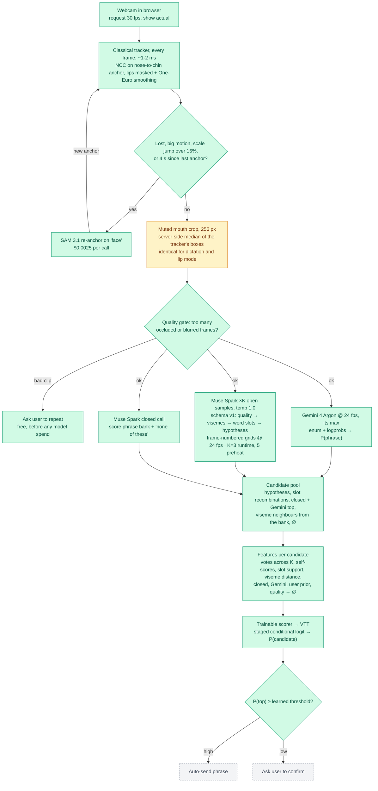
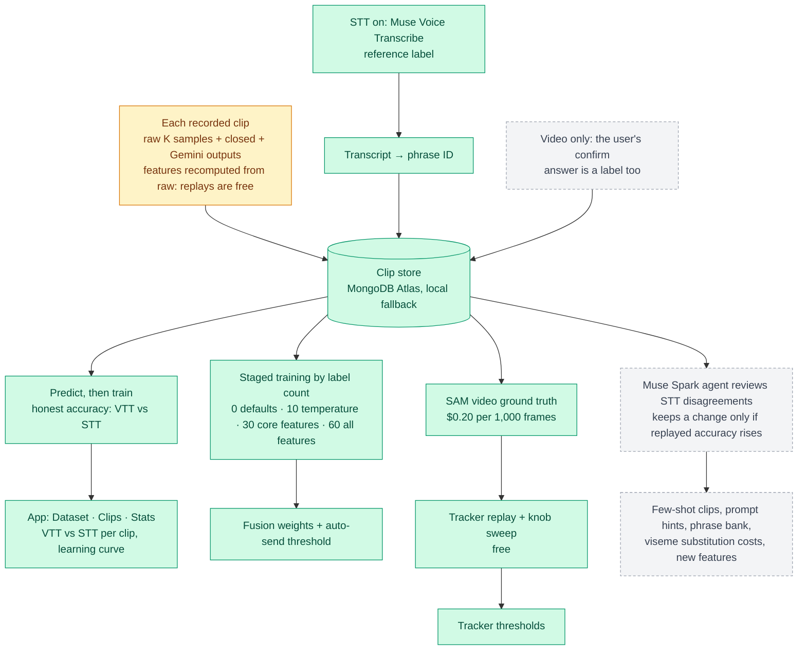
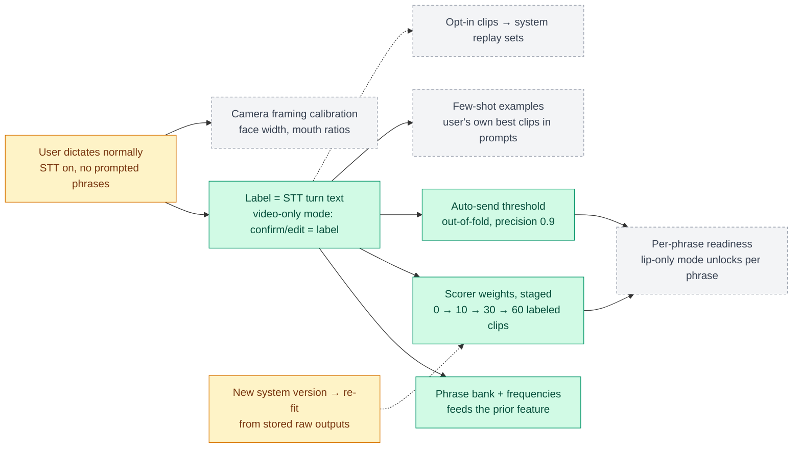
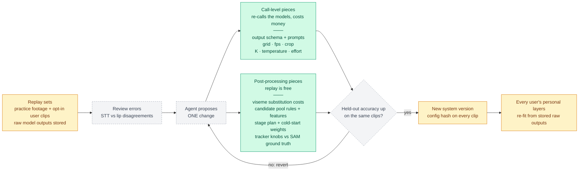

# Pipeline

Green = built and verified · amber = being built · grey dashed = planned. The app's Pipeline page (`/pipeline.html`) renders this file live; edit it and reload.

## Runtime: what happens to one clip

## Learning: how it gets better

## Personal loop: learns from each user's own dictation

## System loop: what we iterate, versioned v1 → v2

## Stages at a glance

| Stage | Where | Cost per clip |
|---|---|---|
| Capture + tracking | Browser | Free; SAM only on re-anchor ($0.0025 each) |
| Quality gate | Browser | Free |
| Lip reading @ 24 fps | Gemini + Muse Spark, in parallel | ~4 s + ~14 s, run concurrently |
| Fusion + gate | Local Python | Free, milliseconds |
| STT label (STT-on only) | Muse Voice Transcribe | Per minute of audio |
| Training + accuracy | Local Python | Free |
