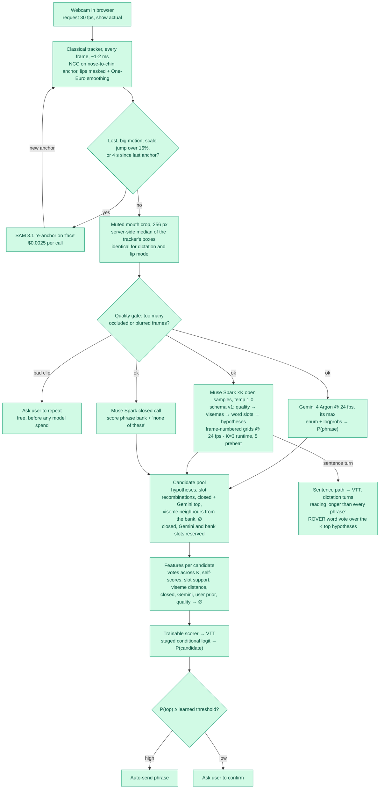
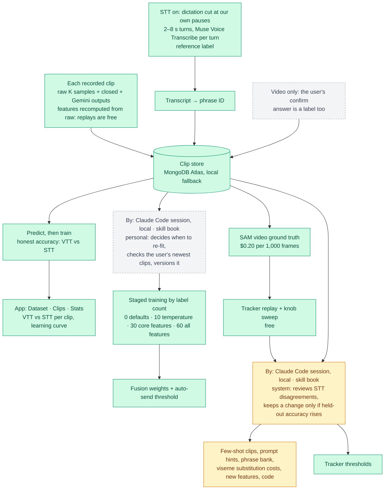
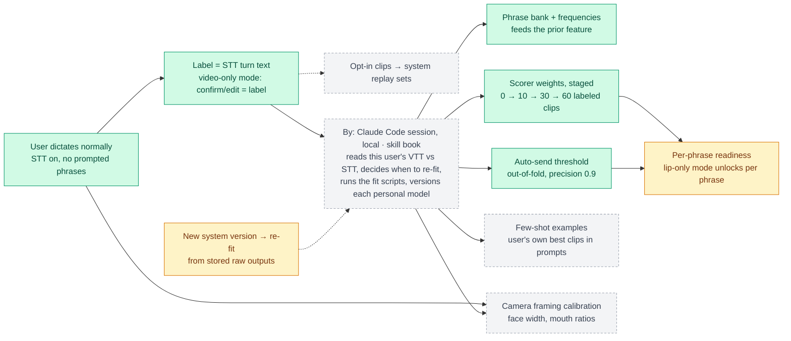
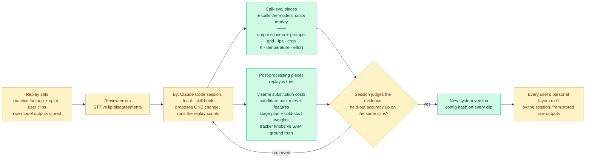
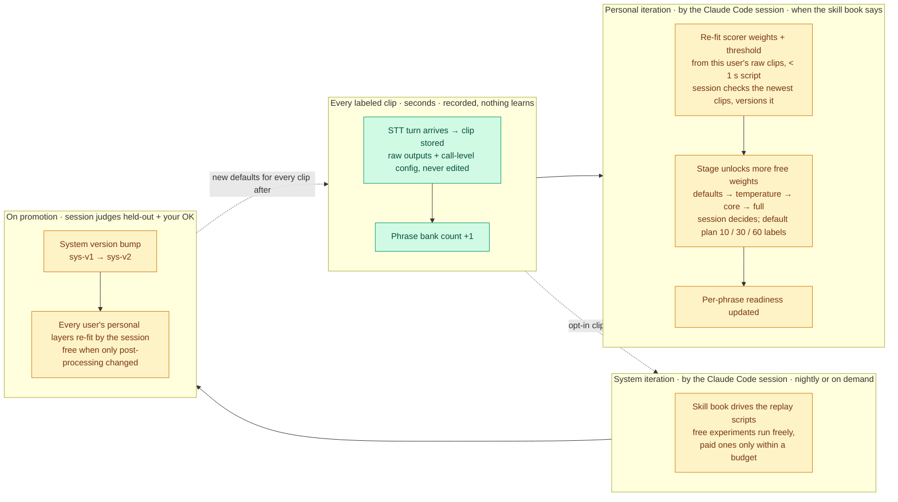
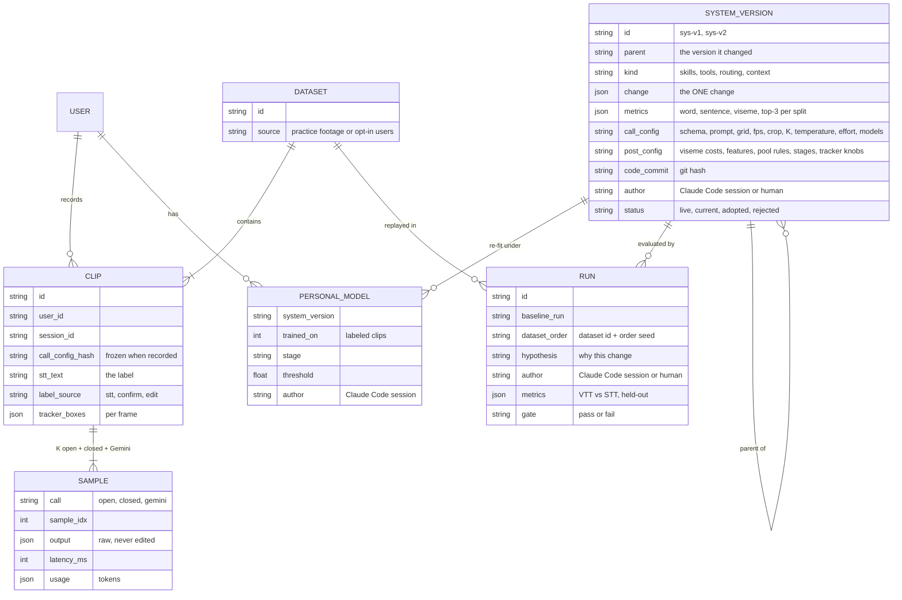
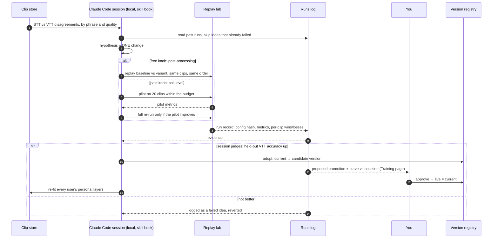

# Pipeline

Green = built and verified · amber = being built · grey dashed = planned. The app's Pipeline page (`/pipeline.html`) renders this file live; edit it and reload.

**Who updates:** every iteration, system and personal, is run by a local Claude Code session following the skill book. Scripts are its instruments and report evidence; the session decides and versions each change. Nothing learns by itself in code. Muse agents are reserved for the product, later.

## Runtime: what happens to one clip

## Learning: how it gets better

## Personal loop: learns from each user's own dictation

## System loop: what we iterate, versioned v1 → v2

## Update cadence: when each piece learns

## Versioning: what every clip, model, and run records

A personal model is never stored as opaque weights: it is a deterministic re-fit of (system version, the user's raw
clips up to `trained_on`), chosen and recorded by the Claude Code session, so any version can be rebuilt, compared,
or rolled back.

## Agent iteration: how one change gets in

## Stages at a glance

| Stage | Where | Cost per clip |
|---|---|---|
| Capture + tracking | Browser | Free; SAM only on re-anchor ($0.0025 each) |
| Quality gate | Browser | Free |
| Lip reading @ 24 fps | Gemini + Muse Spark, in parallel | ~4 s + ~14 s, run concurrently |
| Fusion + gate | Local Python | Free, milliseconds |
| STT label (STT-on only) | Muse Voice Transcribe | Per minute of audio |
| Training + accuracy | Local Python | Free |
