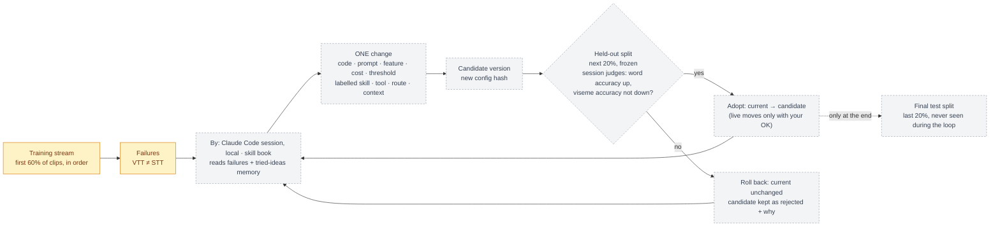

# Self-improvement — the base problem, demonstrated on lip reading

> Build an autonomous coding system that completes a hard, tightly coupled software task and improves itself as it
> works. Each failure becomes a versioned change to its skills, tools, routing or context, and each change has to prove
> itself on held-out work. How can it keep making progress over a long task, adopt only the changes that held-out
> evaluation confirms, and roll back the rest?

## How badge-machine answers it

| The statement | In badge-machine |
|---|---|
| A hard, tightly coupled task | VTT (video-to-text): tracker → crop → Muse ×K + closed + Gemini → candidate pool → features → scorer. A change anywhere shifts everything downstream. |
| Each failure… | A clip where VTT ≠ STT (the label) in the training stream. |
| …becomes a versioned change | The iterating agent, a local Claude Code session following the skill book, groups failures and proposes ONE change (code, prompt, feature, cost, threshold) → a candidate system version with its own config hash and author. Muse agents are reserved for the product, later; `iterate.py`'s Muse proposer is a secondary tool. |
| …to skills, tools, routing or context | Every change is labelled with one of these four kinds; the table below lists common ones, not a closed list. |
| Each change must prove itself on held-out work | Chosen on the training stream's failures, judged on a frozen held-out split the agent never sees. |
| Keep making progress over a long task | Version registry + runs log + tried-ideas memory persist in MongoDB; the session's work is resumable and budgeted, and the skill book says when to stop. |
| Adopt only confirmed changes, roll back the rest | The `current` version pointer moves only when the session judges the held-out evidence better; failed candidates are kept as `rejected` versions with their evidence, so nothing is lost and nothing regresses. |

## Performance is versioning

Every point on the accuracy chart **is a system version**: `{id, parent, kind, change, hypothesis, failures cited,
config hash, code commit, metrics per split, delta vs parent, cost, status}`. Adopting moves a pointer; rolling back
moves nothing — the rejected version stays in the registry with its evidence. Two pointers keep autonomy and control
apart: **`current`** is the best version so far, and the Claude Code session moves it when the held-out evidence says the
candidate is better; **`live`** is what
real users run and moves only when you approve. Any version can be rebuilt, re-evaluated, or made live again, because a
version is a config over immutable raw outputs.

## Change space — what the agent may change

| Kind | Change | Replay cost |
|---|---|---|
| **Skills** | A hint added to the open-call prompt; schema field guidance | paid (re-calls Muse) |
| **Tools** | Viseme substitution costs; feature on/off; pool cap; tracker knobs | free |
| **Routing** | Which sources feed the pool; K used (1–5 of the stored samples); call Gemini only when Muse samples disagree; stage plan | free |
| **Context** | Phrase-bank curation; prior strength; few-shot example clips | free / paid |

Free changes replay stored raw outputs, so the loop can try many. Paid changes run a 20-clip pilot first, within the
run's budget, and a full replay only if the pilot improves.

## Splits — why "held-out" means something

Chronological per dataset: **training stream** (first 60%: personal fitting + the failures the agent sees) →
**held-out** (next 20%: the adopt/roll-back gate, never shown to the agent) → **final test** (last 20%: reported once,
at the end, to show the gate itself wasn't overfit).

## Metrics — easy to read

| Metric | Plain meaning |
|---|---|
| **Word accuracy** (1 − WER) | % of spoken words VTT got right — the headline number |
| Sentence accuracy | % of utterances VTT got exactly right |
| Viseme accuracy | % of mouth shapes right — the fair ceiling, since lips can't show p vs b vs m |
| Top-3 accuracy | % where the right answer is among the 3 options offered to confirm |
| Auto-send precision / coverage | when it sends without asking, how often it's right / how often it dares to |
| Cost per clip | dollars per clip at the current version |

## The demo chart

X = iteration, Y = held-out word accuracy. A staircase line for the adopted version, a dot for every attempted
change (green = adopted, red = rolled back), each dot labelled with its kind and hypothesis — and the final-test number
next to the last step.
