# Training v1 — approval sheet

Status: **DRAFT, awaiting approval.** Tick the boxes in "Approve" at the bottom (or say what to change).

```mermaid
flowchart LR
  SRC["Obama addresses<br/>as fake webcam + mic"] --> CUT["Webcam-emulated sessions<br/>→ STT turns = clips + labels"]
  CUT --> CROP["Mouth crop<br/>tracker + SAM"]
  CROP --> CALLS["7 model calls per clip<br/>Muse open ×5 · Muse closed · Gemini"]
  CALLS --> RAW[("Raw outputs stored<br/>MongoDB Atlas")]
  RAW --> POOL["Candidate pool<br/>+ 13 features + ∅"]
  POOL --> SCORE["Staged scorer<br/>trained clip by clip"]
  SCORE --> OUT["Learning curve · accuracy<br/>clips needed · cost"]

  classDef frozen fill:#f3f4f6,stroke:#9ca3af,color:#374151
  classDef trained fill:#dbeafe,stroke:#2563eb,color:#1e3a8a
  classDef result fill:#d1fae5,stroke:#059669,color:#064e3b
  class SRC,CUT,CROP,CALLS,RAW,POOL frozen
  class SCORE trained
  class OUT result
```



Grey = fixed for the whole v1 run · blue = what v1 trains · green = what v1 tells us.

## 1. Data — natural preheat (no prompted phrases)

| | v1 |
|---|---|
| Source | Public-domain Obama Weekly Addresses, made to look exactly like laptop-webcam input: fixed 4:3 window, face ≈ 30% of frame width, 640×480 @ 30 fps, played into Chrome as a fake camera + mic and recorded by our real page |
| Unit | One dictation session (20–30 s) → split by our STT into turns → one clip per turn ≤ 8 s |
| Label | Muse Voice Transcribe's turn text — exactly what a real user's STT would give (official transcripts are not used) |
| Phrase bank | Learned from the STT history (what the speaker actually says); `phrases.txt` is only an optional seed |
| User id | `practice:obama-weekly:obama`, kept apart from your real data |
| Order | Sessions in chronological order, fixed, so v1 and every later version replay the same sequence |

## 2. Calls per clip (fixed in v1)

| Call | Model | Settings |
|---|---|---|
| Open sample ×5 | `muse-spark-1.3` | schema v1, prompt `p2`, 2×2 frame-numbered grids, 24 fps, temperature 1.0, effort `low` |
| Closed scoring ×1 | `muse-spark-1.3` | top-N phrase bank + "none of these" |
| Gemini ×1 | `gemini-4-argon` | enum over the phrase list + logprobs, 24 fps |
| Crop | tracker (free) + SAM `face` keyframes | `crop: v1` (tracker defaults, T_REFRESH 4 s) |

## 3. Output format: one open sample (schema v1)

```json
{ "schema_version": "v1",
  "speech":     { "present": true, "frames": [4, 71] },
  "quality":    { "mouth_visible": "full", "blur": "low", "occluded_frames": [[60, 66]] },
  "visemes":    [ { "v": "O", "f": [4, 9] }, { "v": "P", "f": [10, 13] } ],
  "slots":      [ { "f": [4, 22], "alts": [ { "w": "open", "s": 0.7 }, { "w": "oven", "s": 0.2 } ] } ],
  "hypotheses": [ { "text": "open the terminal", "s": 0.55 }, { "text": "open the turbine", "s": 0.25 } ] }
```

Written in this order (observe → visemes → words → sentences); verified on live calls. Scores are raw features,
not probabilities.

## 4. Features the scorer sees (13 per candidate)

| Feature | From | Meaning |
|---|---|---|
| `vote` | Muse ×5 | share of samples that list this sentence |
| `top_vote` | Muse ×5 | share of samples where it is the top sentence |
| `mean_score` | Muse ×5 | its average self-reported score |
| `slot_support` | Muse ×5 | share of its words found among the per-word alternatives |
| `viseme_sim` | Muse ×5 + CMUdict | how closely its mouth shapes match the observed visemes |
| `closed` | Muse closed | its closed-call score |
| `gemini` | Gemini | its Gemini probability |
| `prior` | your history | how often this speaker says it |
| `in_bank` | phrase list | 1 if it is a known phrase |
| `is_none` | — | marks the ∅ "none of these" candidate |
| `none_closed` | Muse closed | the closed call's "none of these" score (∅ only) |
| `bad_quality` | Muse ×5 | share of samples reporting a partial/hidden mouth or heavy blur (∅ only) |
| `no_speech` | Muse ×5 | share of samples reporting no speech (∅ only) |

## 5. What v1 trains vs. keeps fixed

| | Knob | v1 |
|---|---|---|
| **Trained** | Scorer weights (13) | staged by labeled clips: 0 hand-set → 10 one scale → 30 nine weights → 60 all 13 |
| **Trained** | Auto-send threshold | out-of-fold, target precision 0.9; ∅ never auto-sends |
| Fixed | Prompt, schema, grid, fps, K, temperature, effort | as in section 2 |
| Fixed | Viseme substitution costs | uniform (every mismatch costs 1) |
| Fixed | Tracker knobs | current defaults |
| Fixed | Pool rules | ≤24 candidates; top 3 from closed, Gemini, and nearest bank entries |

Fixed knobs are v2 material: each change is one versioned experiment on the same clips.

## 6. How v1 is measured

- **Learning curve:** predict-then-train over the fixed order — every clip is scored before its label is learned.
  Lines for the fused scorer, Gemini alone, and Muse alone.
- **Clips needed for preheat:** the clip count after which rolling accuracy gains less than 2 points over the next 20 clips.
- **Final numbers (last 20% of clips):** top-1 accuracy, pool recall (how often the right answer is among the
  candidates), auto-send precision and coverage, confidence vs. accuracy, cost and latency per clip.

## 7. v1 → v2: what costs what

| Change | Needs new API calls? | Cost |
|---|---|---|
| Features, viseme costs, stages, pool rules, threshold target | No — replay stored raw outputs | free, minutes |
| Prompt, grid, crop, K, effort, temperature | Yes — re-run the same clips | same as the first run |

Every run stores its dataset + order seed, full config, and metrics, so any two versions compare on identical clips.

## 8. Cost

Measured: one clip's 18 frame grids = 5,587 Muse input tokens. Output tokens are estimated until the first batch.

| Per clip, K=5 | ≈ |
|---|---|
| Muse open ×5 | $0.10 |
| Muse closed | $0.01 |
| Gemini | $0.03 |
| Crop (SAM keyframes) | $0.01 |
| STT (Muse Voice Transcribe, $0.18/hour) | < $0.001 |
| **Total** | **≈ $0.15** |

100 clips ≈ $15 · 300 clips ≈ $45. On public-domain footage only, Muse's contributor tier would cut this to ≈ $0.05
per clip, but Meta may then train on those prompts.

## 9. Ready to run when

- [x] Schema v1 sampler with reasoning-order keys
- [x] Visemes, candidate pool, staged scorer
- [ ] Integration: store raw outputs + per-sample logs; stats from the scorer
- [x] Practice footage chosen: Obama Weekly Addresses (public domain)
- [ ] Webcam emulation of the footage (agent running)
- [ ] Session → STT turns → clips on the server
- [ ] Clip explorer and Training pages in the app
- [ ] Your approval + budget cap

## Approve

- [ ] Output format (section 3)
- [ ] Features (section 4)
- [ ] Trained vs. fixed (section 5)
- [ ] Measurement (section 6)
- [ ] Budget cap for run 1: ____ clips / $____
